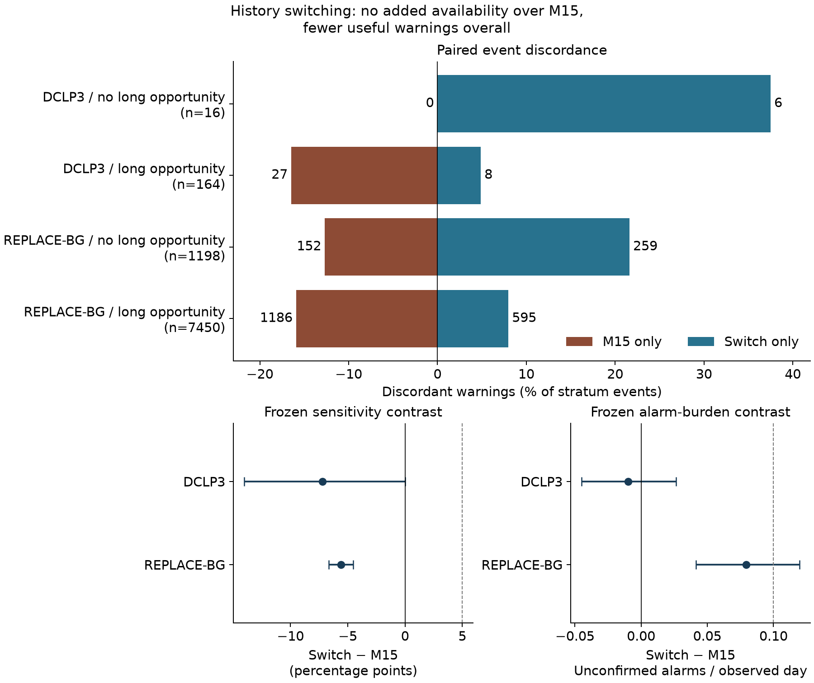
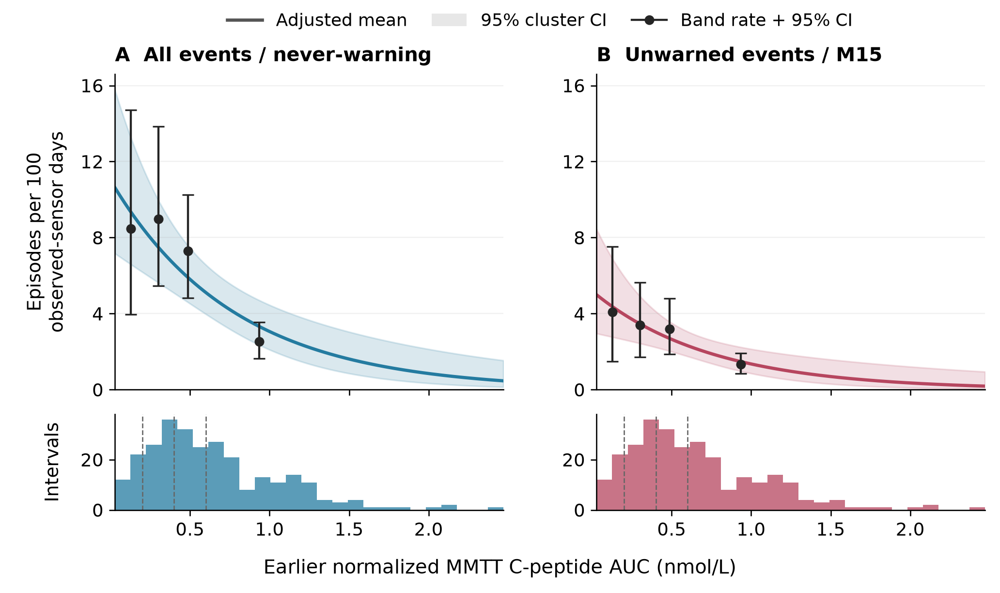

# When fewer unwarned events do not mean better warnings

**External warning inferiority and the event frequency contribution to residual hypoglycemia**  
UCP Technology LLC · 22 October 2026

**Fewer missed low-glucose events can reflect fewer events overall, rather than better warnings. This research separates those explanations and tests whether a warning strategy transfers between populations.**

[Read the paper](manuscript/paper.pdf) · [Methods and scientific appendices](manuscript/paper.md#methods) · [Reproduce the analyses](docs/REPRODUCING.md) · [Claim-to-result map](docs/RESULTS_MAP.md) · [Verification record](provenance/verification.json)

The scientific aim is reducing harm from type 1 diabetes. Using existing datasets, this project contributes computational evidence about warning performance across populations and the relationship between earlier insulin secretion and later low-glucose events. A separate analysis examines molecular groups and the time teplizumab adds before stage 3 diabetes. Each investigation retains its own population and outcome; their effects are not pooled.

## Findings

| Investigation | Main finding | What it means |
|---|---|---|
| **Warning strategy transfer** · DCLP3 → REPLACE-BG | The switching strategy warned of **484 fewer events** than the simpler comparator and generated more unconfirmed alarms. | The prespecified strategy was inferior after transfer. Both policies exceeded the study-defined alarm cap. |
| **Insulin secretion and later events** · CLVer | Higher earlier secretion was associated with fewer later low-glucose events, both overall and without an advance warning. | Fewer unwarned events did not establish better warning performance. The association does not establish causation. |
| **Molecular groups and disease delay** · TN10 | Groups showed different estimated benefits from teplizumab, but the prespecified evidence criterion was not met. | The analysis does not establish a validated way to select treatment. |

See [the paper](manuscript/paper.pdf) for detailed estimates, uncertainty intervals, endpoint definitions, decision rules and study-specific limitations.

## The evidence in two figures



**Frozen warning comparison.** Policy-exclusive warning counts expose gains and losses on the same events. Switching warned 484 fewer external events overall. Its −591 net difference among events with long-history opportunity outweighed the +107 difference among events without one. These are net differences, not counts of uniquely rescued events.



**Total events and residual events move together.** Points show empirical exposure-band rates; curves show adjusted modeled rates; lower panels show exposure support. The never-warning reference turns residual events into total events and helps distinguish event frequency from warning performance.

The paper also includes [TN10 outcome curves](manuscript/figures/tn10_curves.png) and [bootstrap and follow-up uncertainty](manuscript/figures/tn10_uncertainty_profile.png).

## Quick start

Work directly from the repository root. Use Python **3.12.14** and the [pinned environment](requirements-lock.txt). Keep the environment, provider inputs, and generated output outside this directory. No particular drive letter is required. These commands are shown for PowerShell; POSIX equivalents are in [reproduction instructions](docs/REPRODUCING.md).

```powershell
python -m venv ../t1d-env
& ../t1d-env/Scripts/python.exe -m pip install -r requirements-lock.txt
& ../t1d-env/Scripts/python.exe -I -B src/release.py verify
& ../t1d-env/Scripts/python.exe -I -B src/release.py tests --output-root ../t1d-tests
```

`verify` checks the recorded file hashes; `tests` runs the included implementation checks. Full analysis reproduction uses the original datasets below. Repository verification details are in the [reproduction instructions](docs/REPRODUCING.md#verify-repository-files).

After obtaining the **six original provider files** described in [dataset acquisition](docs/DATASETS.md), place them in one input directory and run:

```powershell
& ../t1d-env/Scripts/python.exe -I -B src/release.py inputs --inputs-root ../t1d-inputs
& ../t1d-env/Scripts/python.exe -I -B src/release.py reproduce --inputs-root ../t1d-inputs --output-root ../t1d-run
```

This pipeline prepares data from the original archives, trains the committed warning-model grid, freezes its validation choices, replays both test cohorts and CLVer, fits the clinical models, reconstructs TN10 scores and uncertainty, and compares evidence and all four figures against the paper. It preserves seeds, thresholds, split rules and endpoints. Output must be new and separate from inputs and repository files. Original source data are read-only; participant-level derived files stay in your chosen output directory.

## Reproducibility paths

| Path | Inputs | What is established |
|---|---|---|
| **Verify repository results** | This checkout | Integrity of the paper, aggregate evidence, code, and manifests. |
| **Reconstruct from intermediates** | A completed reproduction tree plus original TN10 inputs | Endpoint accounting, saved quadratic contrasts, 10,000-draw assignment replay and follow-up profiles; no clinical refitting. |
| **Reproduce from original datasets** | Six checksum-verified provider files | Data preparation, model development, replay, estimation, diagnostics and figure generation without an author's retained cache. |

The completed original-source run on **23 October 2026** passed **82 tests**, reproduced **54 aggregate evidence files** and all **four figures** with exact pixels, and passed **seven exact intermediate-reconstruction checks**. Its recorded stage time was **78.05 minutes** in the declared environment. The [scientific verification record](provenance/scientific_verification.json) preserves that completed run. The [current repository verification record](provenance/verification.json) reports checkout integrity and cleanup checks separately. See [verification scope](docs/VERIFICATION.md) for the distinction.

The [result map](docs/RESULTS_MAP.md) connects each principal claim, table and figure to its inputs and generating code. [Original-input identities](provenance/source_data.json), [intermediate dependencies](provenance/external_dependencies.json), and [aggregate provenance](provenance/evidence_sources.json) are machine-readable.

## Repository map

```text
manuscript/        Authoritative paper in PDF, Markdown, TeX and Word; four figures
src/               Scientific implementations, independent checks, portable runners
tests/             Public scientific tests and release-safety checks
evidence/          Frozen aggregate results; no participant-level source datasets
protocol/          Scientific methods and post-results diagnostic specifications
docs/              Acquisition, reproduction and claim-to-result instructions
provenance/        Dataset identities, result mapping and verification records
literature/        Documented search supporting the scoped combined-analysis claim
```

The complete paper supersedes earlier separate drafts. Historical revisions do not replace its frozen findings. The contribution is the specified combined empirical analysis and its separation of event frequency, opportunity, warning conversion, untreated prognosis and added treatment benefit. The [documented literature search](literature/priority_search.json) states the scope of the priority claim.

## Citation and source terms

UCP Technology LLC. (2026). *External warning inferiority and the event frequency contribution to residual hypoglycemia*. Computational research manuscript, 22 October 2026. See [CITATION.cff](CITATION.cff). Citation metadata describes the manuscript and its scientific implementation.

Provider archives are obtained from Jaeb, Zenodo and JCI; they are not bundled. [Third-party notices](THIRD_PARTY_NOTICES.md) preserve source attribution and identify applicable terms. The owner has not selected a blanket license for the original code and manuscript; [license status](LICENSE_STATUS.md) records that publication decision. The repository contains the paper, scientific code, aggregate evidence and the instructions needed to reproduce them.
