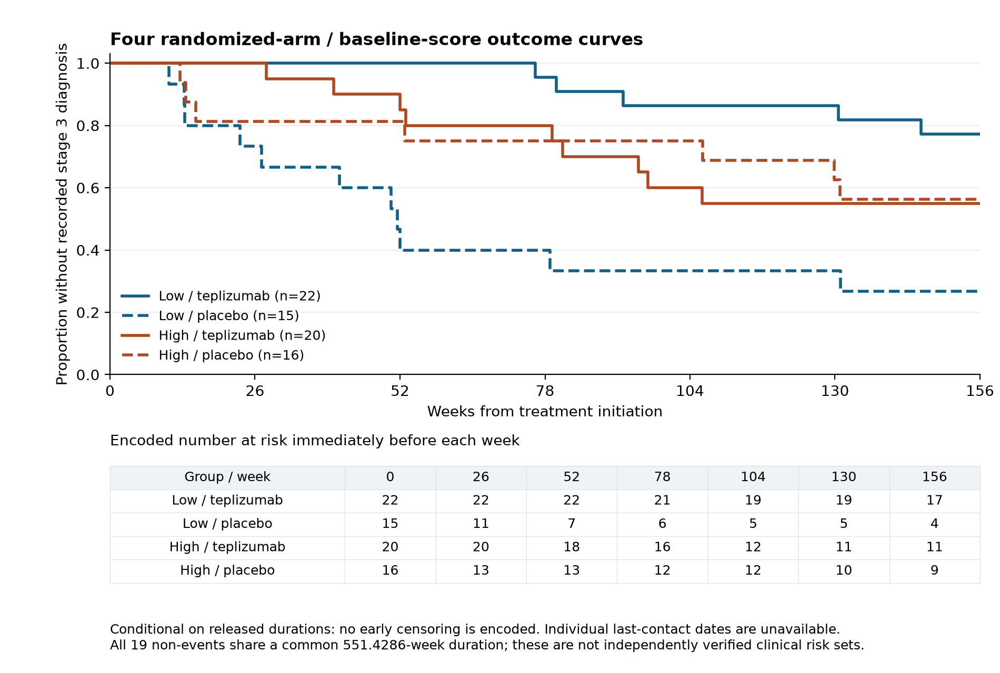

# Abstract

**Background.** A low burden of hypoglycemic events remaining unwarned can reflect fewer events, more opportunities to predict them, or better conversion of opportunities into timely warnings. These explanations require separate measurements. We investigated their relationship using frozen warning policies and longitudinal secretion data, with a distinct randomized molecular analysis of disease delay.

**Methods.** Warning models developed in DCLP3 were evaluated internally and transferred without retuning to REPLACE-BG. Every qualifying observed event remained in the denominator, including events without legal prediction history. In CLVer, earlier stimulated C-peptide was related to later total and replay-unwarned event counts under a frozen DCLP3-selected policy. Total-event, never-warning, conditional-warning and matched-sample analyses assessed endpoint interpretation. Separately, a fixed AbATE-derived expression score defined a TN10 contrast in treatment-added stage-3-free time restricted to 156 weeks.

**Results.** In REPLACE-BG, the switch warned 4,831 of 8,648 events versus 5,315 for M15: a difference of -5.60 percentage points (95% interval -6.65 to -4.51). Its unconfirmed alarm rate was 1.479 per observed day; unmatched alarms with observed follow-up alone contributed 1.285. The switch also had lower internal sensitivity, so the external result establishes comparative inferiority rather than sensitivity deterioration caused by transfer. In CLVer, 178 of 180 unwarned events had a legal input opportunity. Per additional 0.20 nmol/L earlier C-peptide, unwarned-event and total-event rate ratios were 0.764 (0.626 to 0.896) and 0.774 (0.674 to 0.870); the conditional unwarned-event odds ratio was 0.978 (0.785 to 1.218). The TN10 interaction was 69.18 weeks, with fixed-group and reconstructed-score intervals of 20.49 to 117.86 and 1.42 to 104.87. Ascertainment through the restriction horizon remains unverified for 19 encoded non-events.

**Conclusions.** The frozen switch warned fewer events than M15 externally, and the alarm-burden constraint did not transport. Higher earlier secretion was associated with fewer later observed events, including unwarned events, without establishing a distinct improvement in warning performance. Residual burden should be reported jointly with event frequency, opportunity, warning conversion and alarm burden.

# Introduction

An advance warning is useful only if it arrives before an event and imposes a tolerable alarm burden. Forecast accuracy alone does not answer that operational question. Sustained-low prediction, glucose-region metrics and event-based evaluation have established relevant methods [1-3]. More recent work evaluates event recall alongside false alarms per patient-day, and externally validates week-ahead hypoglycemia prediction [4,5]. A remaining question is what a warning-conditioned outcome means when a policy changes cohorts and the underlying event rate varies between people.

The distinction matters when studying endogenous insulin secretion. Prior studies associate C-peptide with glycemia and hypoglycemia, including analyses within CLVer [6,7]. If children with higher secretion experience fewer events, they may also experience fewer events left unwarned even when warning performance is unchanged. A residual-event association therefore needs interpretation against the total-event process and the policy that defines the residual.

We address this question by connecting fixed warning-policy evaluation to forward secretion analyses through a shared event definition and replay policy. DCLP3 supplies model development; REPLACE-BG supplies external evaluation; CLVer supplies earlier secretion and later event outcomes. A separate TN10 component examines a related question on a different scale: how baseline molecular grouping separates untreated prognosis from randomized treatment-added time before stage 3 diabetes [8-10]. The program estimates each contrast in its own population and outcome units.

UCP Technology LLC claims priority for the specified combined empirical analysis: preserved observable-event denominators and paired warning/burden accounting in frozen DCLP3-to-REPLACE-BG transport; forward CLVer total-event and replay-unwarned analyses under a DCLP3-selected policy with never-warning and conditional-warnability controls; and the separately estimated fixed-AbATE-score TN10 156-week randomized treatment-benefit contrast. This is the first report of that combination identified in our documented search of primary studies and preprints through 22 October 2026. Its contribution is the empirical design and the distinctions it resolves between event frequency, warning performance, baseline prognosis and added treatment benefit.

# Methods

## Residual events as an accounting problem

Let $E$ denote qualifying observed events, $O$ events with at least one legal prediction-input opportunity in the lead window, $W$ events usefully warned, and $D$ observed sensor days. The definitions enforce $W\leq O\leq E$. Residual events satisfy

$$
E-W=(E-O)+(O-W).
$$

The first term counts events lacking a legal input opportunity; the second counts events with an opportunity that the complete warning policy did not convert into a useful warning. When $E$, $O$ and $D$ are positive,

$$
\frac{E-W}{D}=\frac{E}{D}\left[1-\frac{O}{E}\frac{W}{O}\right].
$$

Thus, residual-event rate combines total-event rate, opportunity coverage and warning conversion conditional on opportunity. These are exact descriptive identities. They do not decompose adjusted regression coefficients or identify the effect of intervening on secretion. If $E=0$, event sensitivity is undefined; if $O=0$, opportunity conversion is undefined. Count identities still hold, and observed time remains in burden accounting. A never-warning policy gives $W=0$ and makes residual events identical to total events.

## Cohorts and analysis hierarchy

Table 1 summarizes the study populations. DCLP3 allocated 113, 29 and 26 participants to training, validation and internal testing; 107, 24 and 22, respectively, contributed usable raw-stream observations. Participants without observations remained in allocation accounting. REPLACE-BG included 225 participants after the frozen exclusions. DCLP3 windows began at randomization and REPLACE-BG windows at enrollment, including run-in. Both used day 0 through before day 182, truncated earlier at the documented final-visit whole day: the 26-week visit for DCLP3 and the dated non-missed visit or death endpoint for REPLACE-BG. The primary CLVer sample required valid temporal/assay pairs and at least 70% observed CGM coverage in each 28-day outcome interval. TN10 included 73 baseline RNA libraries interpreted as 73 participants, of 76 randomized in the original trial.

Table 1. Populations and analytical roles

| Source | Role and population | Observation or outcome |
|:--|:--|:--|
| DCLP3 | Development and internal test; 168 allocated, 153 observed | 1,422/283/180 training/validation/test qualifying events |
| REPLACE-BG | External fixed-policy evaluation; 225 participants | 8,648 events over 36,376.47 observed days |
| CLVer | Earlier secretion and later events; 102 children, 276 intervals | 408 events over 7,293.40 observed days |
| TN10 | Randomized treatment-by-score contrast; 42 teplizumab, 31 placebo | Released stage-3-free durations restricted to 156 weeks |

Primary questions, outcomes, operating thresholds and original decision rules were fixed before the warning-policy test evaluations and clinical outcome contrasts. TN10 used the full 73-record baseline subset in an outcome-blind-specified secondary reanalysis; it had no held-out evaluation sample. Additional diagnostic analyses were specified after the primary results and are exploratory. They did not replace the primary operating policy. Detailed cohort flow, source handling, model development and decision rules appear in the scientific appendices.

## Event detection and frozen warning policies

A qualifying low episode required four consecutive five-minute readings below 54 mg/dL, spanning 15 minutes. Four consecutive readings at or above 54 mg/dL rearmed event counting. Gaps reset state; a low run with unknown onset after a gap was not assigned an onset. Missing glucose was not interpolated. A useful warning occurred 15-30 minutes before an eligible onset. Every qualifying observed event stayed in the evaluation denominator, including events without model history.

Histogram gradient-boosting models used either four consecutive readings spanning 15 minutes (M15), 25 readings spanning 120 minutes (M120), or a separate missingness-aware history representation. Participant-separated development selected a standalone M15 threshold of 0.04. The frozen switch used M120 at 0.04 when long history was available and M15 at 0.01 otherwise. Since long history contains short history, $A_{M120}\subseteq A_{M15}$ and $A_{switch}=A_{M15}$. Switching therefore changes predictions, thresholds and their interaction with alarm timing while retaining M15 input availability.

The replay suppressed alarms when glucose was already below 54 mg/dL and imposed a 30-minute refractory interval. Each warning and event could be matched once. Unconfirmed alarms included unmatched alarms with observed follow-up, late alarms, duplicate alarms and alarms with unobservable outcomes; these categories were retained separately. Observed days were five-minute observed bins divided by 288. Alarm caps were study-defined operating constraints: at most one unconfirmed and two total alarms per observed day.

Warning-policy intervals used 10,000 paired participant-cluster bootstrap resamples, retaining each sampled participant's full timeline and taking percentile endpoints. Both policies were evaluated on identical resampled participants and events.

## Secretion and warning-conditioned outcomes

Earlier secretion was the trapezoidal six-timepoint MMTT C-peptide integral over 0-120 minutes divided by 120, in nmol/L. The primary Poisson pseudo-maximum-likelihood model related later unwarned-event counts to secretion per additional 0.20 nmol/L, with log observed days as offset and adjustment for target visit, assay-to-window lag, age, management system and cohort. Outcome windows lay after the earlier assay and before the later assay, using the 28 days preceding that later assessment. Zero-event intervals were included.

The primary and total-event uncertainty intervals used 5,000 child resamples stratified by randomized delivery arm. Sensitivity models used child-cluster sandwich intervals unless stated otherwise. A paired bootstrap compared the log rate ratios for unwarned and all events using identical child draws. An event-level logistic analysis estimated the odds of remaining unwarned conditional on a qualifying event, with the same adjustment structure and child-cluster uncertainty. This conditional outcome excludes zero-event intervals by construction.

To separate changes in sample from changes in estimand, the original pooled model was refitted on the exact children and intervals retained by the within-child analysis. A quadratic secretion model supplied exposure-specific contrasts already available from the original sensitivity analysis. Clinical remission, separately defined as IDAA1c at most 9, was analyzed as an additional exposure [11].

## Randomized disease-delay contrast

The TN10 component projected the fixed 359-gene AbATE negative-correlation list onto 312 exactly matching TN10 symbols [10]. Pooled baseline log2(1+CPM) values were standardized per gene; their unweighted mean defined the score. Values strictly above the pooled median defined the high group. Gene selection and grouping used no TN10 outcomes.

For released duration $T$, define $Y=\min(T,156)$ weeks. The estimand was the low-minus-high difference in randomized-arm restricted-time contrasts,

$$
\theta=(\overline{Y}_{T,low}-\overline{Y}_{P,low})-(\overline{Y}_{T,high}-\overline{Y}_{P,high}).
$$

The primary Welch-Satterthwaite interval treats the observed groups as fixed. A 10,000-draw arm-stratified bootstrap reconstructs gene standardization, score, median and group assignments in each draw. Continuous-score models estimate a different functional form: the treatment-by-standardized-score interaction, unadjusted and adjusted for age and HbA1c, with HC3/t uncertainty.

All released durations support a complete numerical calculation of the restricted outcome. However, all 19 encoded non-events share 551.4286 weeks, the largest recorded event duration rounded to four decimals, without individual last-contact dates. This common encoding does not establish that their outcomes are wrong or that ascertainment through 156 weeks is complete. Analyses therefore distinguish sampling uncertainty conditional on the released outcomes from uncertainty about their clinical ascertainment. A sensitivity profile permits uncertain restricted outcomes to lie between a common assumed verified minimum $L$ and 156 weeks; it does not treat later RNA collection as proof of stage-3-free status.

# Results

## The switch warned fewer events and the alarm constraint did not transport

Internal test sensitivities were 62.22% for M15 and 55.00% for switching, a difference of -7.22 percentage points (95% interval -14.05 to 0.00). Externally, they were 61.46% and 55.86%, a difference of -5.60 points (-6.65 to -4.51). The external result provides clear evidence of comparative inferiority for this frozen switch. It does not show a sensitivity advantage disappearing after transfer: the switch already warned fewer internal events, and its external sensitivity point estimate was slightly higher.

The separate transport failure concerns alarm burden. The switch's unconfirmed alarm rate was 0.787 internally and 1.479 externally, exceeding the one-per-day cap in REPLACE-BG. External M15 also exceeded the cap, at 1.400. The external switch-minus-M15 difference was 0.079 unconfirmed alarms/day (95% interval 0.042 to 0.120). These cross-cohort values describe different populations and observation windows; they do not estimate a causal effect of changing cohort.

The paired external comparison retained the same 8,648 events. Both policies warned 3,977; M15 alone warned 1,338; switching alone warned 854; neither warned 2,479. Switching therefore warned 484 fewer events. The net difference was +107 among events without a long-history opportunity and -591 among events with one. These are net subgroup differences, not counts of uniquely rescued or uniquely lost events.

{width=6.3in}

The switch generated 46,744 unmatched alarms with observed follow-up over 36,376.47 observed days, or 1.285/day. This category alone exceeds the one-per-day unconfirmed-alarm cap at the point-estimate level. Adding 2,033 late alarms and 5,036 alarms with unobservable outcomes gives 53,813 unconfirmed alarms; no duplicates were recorded. Cap failure therefore persists before counting unobservable outcomes. An unmatched replay alarm is not automatically a clinically unnecessary alarm, since actual responses and their effects are not observed by the replay.

Exploratory fixed-threshold ablations clarify the policy contrast. Using 0.04 for both switch branches reduced external sensitivity by 6.65 points relative to M15 (-7.62 to -5.62), while reducing unconfirmed alarms by 0.225/day. Lowering the fallback threshold to 0.01 recovered 1.05 points (0.54 to 1.55) and added 0.305 unconfirmed alarms/day (0.269 to 0.345). Equal numerical thresholds do not equalize calibration or alarm burden; these comparisons describe complete policies rather than isolating a causal effect of history length.

## Almost all CLVer residual events had an input opportunity

Table 2 makes the accounting distinction explicit. In CLVer, 406 of 408 qualifying events had a legal M15 opportunity and 228 were usefully warned. Of the 180 unwarned events, two lacked an input opportunity and 178 had one. Thus, 98.9% of residual events occurred despite an opportunity. The latter component concerns conversion of an existing opportunity into a timely warning and combines predictions, thresholds, timing and refractory behavior. This descriptive classification does not bound the benefit of changing available history or the warning policy.

Table 2. Event opportunity and useful-warning decomposition

| Cohort and policy | Events $E$ | Opportunity $O$ | Warned $W$ | No opportunity $E-O$ | Opportunity but unwarned $O-W$ |
|:--|--:|--:|--:|--:|--:|
| DCLP3 M15 | 180 | 179 | 112 | 1 | 67 |
| DCLP3 switch | 180 | 179 | 99 | 1 | 80 |
| REPLACE-BG M15 | 8,648 | 8,562 | 5,315 | 86 | 3,247 |
| REPLACE-BG switch | 8,648 | 8,562 | 4,831 | 86 | 3,731 |
| CLVer M15 | 408 | 406 | 228 | 2 | 178 |

CLVer opportunity coverage was 99.51%, warning conversion among events with opportunity was 56.16%, and sensitivity over all events was 55.88%. The primary sample contained 102 children and 276 intervals over approximately 7,293 observed days. The frozen policy's unconfirmed burden was 1.903/day. Intensive and usual-care arms had 2.146 and 1.596 unconfirmed alarms/day, respectively; the intensive arm also exceeded two total alarms/day. The prespecified warning-usefulness transfer condition failed in both arms.

## Secretion associations chiefly tracked underlying event frequency

The primary unwarned-event rate ratio was 0.764 per additional 0.20 nmol/L earlier C-peptide (95% bootstrap interval 0.626 to 0.896). The point estimate corresponds to a 23.6% lower modeled rate; the interval corresponds to 10.4%-37.4% lower rates. The total-event rate ratio was 0.774 (0.674 to 0.870). Because the never-warning outcome is exactly the total-event outcome with the same offsets and sample, its matched analysis has that identical estimate and interval.

Table 3. Central secretion and endpoint comparisons

| Analysis | Children / intervals | Effect per +0.20 nmol/L | 95% interval and method |
|:--|:--|:--|:--|
| Unwarned events, primary pooled model | 102 / 276 | RR 0.764 | 0.626-0.896, child bootstrap |
| All events / never-warning residuals | 102 / 276 | RR 0.774 | 0.674-0.870, same bootstrap |
| Pooled model on within-child sample | 58 / 164 | RR 0.882 | 0.748-1.041, cluster sandwich |
| Within-child model on that sample | 58 / 164 | RR 1.035 | 0.631-1.697, cluster sandwich |
| Unwarned conditional on an event | 72 / 137 event-bearing intervals | OR 0.978 | 0.785-1.218, child-cluster sandwich |
| Paired unwarned / total association | 102 / 276 | Ratio of RRs 0.987 | 0.890-1.079, paired child bootstrap |

The conditional analysis used 408 events from 72 children. Its interval includes associations in both directions. The paired log-rate-ratio difference was -0.0126 (95% interval -0.1162 to 0.0757), equivalent to the ratio of rate ratios in Table 3. These estimates do not establish equivalence or a distinct improvement in warning performance.

Sample restriction materially affects the pooled comparison. The within-child analysis retains 58 children and 164 intervals because children with no unwarned events across their intervals do not contribute. Refitting the original pooled model on those exact rows shifts the rate ratio from 0.764 to 0.882 before changing to the within-child estimand of 1.035. The within-child result is imprecise and does not corroborate the pooled association. It cannot be interpreted as a simple demonstration that between-child confounding explains the original estimate. Repeated information is limited to at most three forward intervals per child; detailed design diagnostics are reported in Appendix B.

{width=6.3in}

The empirical bands show lower total and unwarned rates at higher secretion without a monotonic increase in sensitivity. Across bands below 0.20, 0.20-0.40, 0.40-0.60 and at least 0.60 nmol/L, useful sensitivities were 51.8%, 62.2%, 56.3% and 47.1%. Opportunity coverage was at least 98.6% in every band. The existing quadratic model allows the local rate ratio to change across exposure; its point estimates remain below one across the retained contrasts, while uncertainty is wider at low and high support. Appendix B presents those exposure-specific contrasts rather than imposing a single proportional association throughout the range.

## The TN10 component separates added time from baseline prognosis

The low-score and high-score placebo restricted means were 74.45 and 116.59 weeks. Their observed low-minus-high difference was -42.14 weeks (95% Welch interval -85.16 to 0.88). This mean pattern suggests a prognostic contribution, with uncertainty spanning zero. The high-score group also has less remaining time below the 156-week ceiling. Absolute treatment-benefit heterogeneity depends on that scale and horizon.

Table 4. TN10 group outcomes and interaction uncertainty

| Contrast or group | Participants | Estimate in weeks | 95% interval |
|:--|--:|--:|:--|
| Low score, teplizumab | 22 | 144.38 | 132.92-155.83 |
| Low score, placebo | 15 | 74.45 | 41.71-107.19 |
| High score, teplizumab | 20 | 117.34 | 95.18-139.51 |
| High score, placebo | 16 | 116.59 | 85.77-147.41 |
| Low-score treatment benefit | 37 | 69.93 | 35.79-104.07 |
| High-score treatment benefit | 36 | 0.75 | -35.92-37.42 |
| Low-minus-high interaction, fixed groups | 73 | 69.18 | 20.49-117.86 |
| Same interaction, reconstructed-score bootstrap | 73 | 69.18 observed estimate | 1.42-104.87 |
| Adjusted continuous interaction, weeks/score SD | 72 | -16.02 | -46.60 to 14.57 |

There were 32 recorded diagnoses by week 156, 22 diagnoses later and 19 encoded non-events. Under the released encoding, 41 participants reached the endpoint ceiling. Figure 3 shows group-specific curves and encoded risk counts. For each group, the curve area through 156 weeks equals the corresponding restricted mean in Table 4.

{width=6.3in}

The fixed-group interval and full-score bootstrap interval are 97.37 and 103.45 weeks wide. Their difference is therefore a downward displacement as well as a modest widening. The 10,000 retained draws had mean 54.03, median 54.30 and SD 26.44 weeks, compared with the observed estimate of 69.18. The mean displacement was -15.14 weeks and adjusted sample skewness was -0.065. At least one original group label changed in 8,546 draws. Across distinct in-bag participant-draw appearances, 21,678 of 464,941 labels changed (4.66%). These descriptive summaries do not isolate the contribution of relabeling from changes in resampled composition. The percentile interval describes the specified score-reconstruction resampling distribution; reconstructing more steps does not make it universally preferable to a fixed-group interval, which answers a different conditional uncertainty question.

The adjusted continuous interaction remained imprecise across zero. The unadjusted full-sample estimate was -17.05 weeks/SD (-46.78 to 12.68); the unadjusted complete-case estimate was -19.44 (-49.90 to 11.03). Removing the single participant with incomplete adjustment data raised the dichotomized complete-case interaction to 75.00 weeks (26.41 to 123.59), while the primary full-sample contrast remained unchanged. These functional-form and sample differences are reported together because they affect interpretation.

## Follow-up information determines the TN10 identification range

Allowing all 19 uncertain restricted outcomes to range independently from zero to 156 weeks produces a finite-sample contrast range of -14.14 to 136.78 weeks. This range expresses the information missing from the released ascertainment fields; it is not a sampling interval. The repeated encoded duration alone supplies no evidence that the true outcomes lie at either extreme.

If all 19 participants were independently documented to remain stage-3-free for at least $L$ weeks, the same calculation would give

$$
\theta_{min}(L)=69.1754-(156-L)\left(\frac{9}{22}+\frac{2}{16}\right),
$$

$$
\theta_{max}(L)=69.1754+(156-L)\left(\frac{2}{15}+\frac{6}{20}\right).
$$

The lower endpoint becomes positive above approximately 26.5 verified weeks and exceeds 26 weeks above approximately 75.2 weeks. These are thresholds for the finite-sample identification range under the common-$L$ assumption. They do not incorporate sampling uncertainty or satisfy the primary confidence-interval rule. Participant-specific documented follow-up would sharpen the analysis more directly. The available release does not establish a common verified positive $L$ for these 19 participants.

Table 5. TN10 identification range under assumed common minimum follow-up

| Assumed verified minimum L in weeks | Lower endpoint in weeks | Upper endpoint in weeks |
|--:|--:|--:|
| 0 | -14.14 | 136.78 |
| 26 | -0.26 | 125.51 |
| 52 | 13.63 | 114.24 |
| 78 | 27.52 | 102.98 |
| 104 | 41.40 | 91.71 |
| 130 | 55.29 | 80.44 |
| 156 | 69.18 | 69.18 |

{width=6.3in}

# Discussion

The combined analysis supplies a concrete interpretation of a warning-conditioned outcome. Residual burden reflects how often events occur, whether legal prediction inputs exist, and whether the complete operating policy converts an opportunity into a timely warning. Preserving those counts prevents improvements in input availability or lower residual rates from being mistaken for improvements in warning performance.

The warning result has two parts. The frozen switch was inferior to M15 in external sensitivity, and both policies exceeded the external unconfirmed-alarm cap. Because switching already had lower internal sensitivity, the evidence does not support a story in which a previously successful sensitivity advantage vanished during transport. The failure to preserve the alarm constraint is a separate transport result. Paired discordance and fixed-threshold ablations show where useful warnings were gained and lost and how the lower fallback threshold traded sensitivity for burden.

The CLVer result makes the endpoint issue tangible. Almost all unwarned events had a legal opportunity, and the secretion association for residual events closely resembled that for total events. Conditional-warning and paired-association analyses leave meaningful uncertainty, while the matched-sample analysis shows why comparing pooled and within-child estimates without matching their contributors is misleading. Together, these results support fewer observed events at higher earlier secretion without establishing a distinct improvement in warning performance.

The TN10 component addresses the same general problem of assigning meaning to an apparently favorable endpoint, using a separate randomized contrast. The original trial and later analyses established teplizumab disease delay and beta-cell effects [8,9]; Sassi et al. supplied the expression signature and prior molecular findings [10]. Our fixed-score four-cell analysis asks how much additional restricted time treatment contributes within groups whose observed placebo means differ. The large dichotomized point contrast coexists with score/split instability, an unresolved target magnitude and missing individual ascertainment fields. The follow-up profile states exactly which additional information would narrow that last uncertainty.

The contribution relative to prior work is the specified combination of frozen policy testing and endpoint-specific controls, with a separately quantified randomized disease-delay component. Dave, Mayo, Fleischer, Namazi and Giammarino provide precedents for prediction evaluation [1-5]; Neyman and Pinckney establish secretion-glycemia relationships [6,7]. The present work tests what changes when the biological endpoint is defined by a warning policy and when the treatment endpoint is compared across molecular prognostic groups. The accounting identity organizes those measurements; the scientific result is the observed distribution of failures and the behavior of the estimated contrasts.

Material limitations arise from the measurements and study designs. Observed CGM windows condition on attendance and sensor coverage; events wholly inside gaps are unobserved. Recorded clocks and unknown receipt latency affect replay timing. Existing treatment and device alerts shaped the recorded trajectories, so replay does not identify how a person would respond to a new warning. Secretion analyses remain observational, with limited repeated intervals and possible residual confounding. TN10 has small score-treatment cells, RNA-subset selection, cohort-relative scoring and the specific ascertainment gap described above. These limitations identify the inference each dataset can support and the measurements needed to extend it.

# Conclusion

This frozen switching policy warned fewer events than M15 in external testing, while the study-defined alarm-burden constraint did not transport. In CLVer, 178 of 180 unwarned events occurred despite a legal input opportunity, and higher earlier secretion was associated with fewer later observed events without establishing a distinct improvement in warning performance. The TN10 analysis identified an additive treatment-delay contrast alongside differing observed placebo means; its target magnitude and non-event ascertainment remain unresolved. Reporting event frequency, opportunity, warning conversion, burden and outcome ascertainment together makes these different sources of apparent benefit testable.

# Data and code availability

The accompanying scientific package contains executable domain methods, frozen specifications, aggregate result tables, figure sources and source checksums. DCLP3 release 3, REPLACE-BG and CLVer are available through the Jaeb public-data pages [12-14]. TN10 expression and metadata are available in the versioned molecular release [15], with the gene list in Sassi et al. Supplemental Table 6 [10]. Numerical reconstruction uses these declared source versions and the configured external data root. Participant records are obtained from their original providers under the applicable terms.

The original analyses and subsequent diagnostics have separate preserved records. The new summaries in this paper retain the original model fits, event ledgers, bootstrap draws and operating thresholds. The package provides scripts for the count identities, saved-model nonlinear contrasts, follow-up profile and score-resampling summaries. Independent implementations and 76 scientific/integrity tests check event definitions, source reconstruction and statistical arithmetic.

# Appendix A Detailed warning methods and population context

DCLP3 training, validation and test assignments were fixed by participant. Development used five deterministic participant-grouped folds and four configurations per model family: maximum leaves 7 or 15, L2 regularization 0 or 1, learning rate 0.05, 200 iterations, minimum 50 samples/leaf, and no early stopping. Five folds across four settings for each of three families, followed by three final fits, produced 63 fits. Equal-person sample weights applied during training; reported pooled sensitivity is event-weighted. Participant bootstrap sampling accounts for clustering without changing that estimand.

The validation grid contained 10,772 operating points, including finite linear forecast thresholds of 40-100 mg/dL and a separately labeled never-alarm sentinel. No finite linear point met the alarm caps. The switching comparison used M15 at 0.04 and switching at 0.04/0.01. The CLVer policy was independently selected from the development data under its own specified rule, also yielding M15 at 0.04. External or CLVer outcomes were not used to retune either selection.

Conditional on the trained models, 1,000 resamples of all 29 allocated validation participants repeated the full grid selection. The original comparator recurred in 50.7%, switch thresholds in 25.4%, and their joint selection in 21.2%. Five allocated validation participants had no observations and remained in resampling. This analysis measures operating-point selection stability on the small validation population, not retraining uncertainty.

DCLP3 participants had mean age 32.8 years and mean disease duration 18.8 years; REPLACE-BG participants had mean age 43.9 years and duration 23.4 years. DCLP3 included closed-loop and sensor-augmented-pump treatment, whereas REPLACE-BG evaluated CGM with or without routine blood glucose monitoring. Full DCLP3 coverage was 74.4% of allocated window bins versus 89.9% in the external analyzed windows. Source/device, treatment and observation differences describe the setting of transport; they do not isolate its cause.

There were 77, 16 and 12 unknown-onset low runs in DCLP3 training, validation and testing, and 679 externally. These runs were retained in source accounting but excluded from onset-defined event counts. Among event-bearing participants, mean person sensitivities were 55.1%/46.2% internally and 59.3%/54.8% externally for M15/switch, compared with their event-weighted values in the main results. Zero-event participants have undefined person sensitivity but remain in observed-time and alarm accounting.

Table A1. Original decision rules

| Question | Target and null | Interval condition | Additional conditions |
|:--|:--|:--|:--|
| Switch versus M15 | Gain at least 5 percentage points; null 0 | Lower endpoint above 0, point at least 5 | At least 20 people and 100 events per test cohort; feasibility/precision rules; unconfirmed at most 1/day, total at most 2/day; excess unconfirmed at most 0.10/day |
| Earlier secretion and unwarned rate | RR at most 0.80 per +0.20 nmol/L; null 1 | Upper endpoint below 1; point and lower endpoint at most 0.80 | At least 60 children, 200 intervals and 100 unwarned events across 30 children; overall sensitivity at least 30%; each management arm at most 1 unconfirmed and 2 total alarms/day |
| TN10 low-minus-high added time | At least 26 weeks; null 0 | Lower endpoint at least 26 weeks | Four randomized cells and the specified released-outcome definition |

The TN10 rule requires interval-level support for its target magnitude. The other numerical rules can pass without the entire interval exceeding the target. These original rules govern their own questions. The alarm caps are study-defined thresholds, and an observed cap failure is an operational finding under those thresholds.

# Appendix B Clinical construction and sensitivity results

CLVer began with 113 randomized children and 339 possible forward visit pairs. Complete compatible fasting assays and temporal rules retained 301 pairs from 108 children; coverage retained 276 intervals from 102 children. Included children had median age 11 years (interquartile range 9-13), with 44 usual-care, 37 Tandem and 21 Medtronic participants. The model included target visit, management system, age, cohort and assay-to-window lag. Conditioning on later attendance, assay availability and adequate observation is part of the analysis population.

C-peptide integrals required complete values at 0, 15, 30, 60, 90 and 120 minutes, fasting status and compatible units. Clinical remission used absolute daily insulin divided by measured body weight and central HbA1c within seven calendar days of the index assay. Laboratory peak secretion above 0.30 nmol/L remained a separate measurement. Physical-exam weight inherited its linked visit date as a protocol-based date proxy, rather than an independently measured timestamp.

GXB supplied CGM for Tandem participants and DeviceCGM supplied the other participants. Blank DeviceCGM unit fields were interpreted as mg/dL using protocol and value-domain corroboration; GXB has no unit column. Excluding blank-unit records retained 81 children and 217 intervals, with RR 0.765 (cluster interval 0.641-0.913). Clock-discontinuity bins were unavailable; subsequent internally consistent recorded-local-time segments were retained without an invented clock correction, leaving absolute clock accuracy unverified. Sixty-six date-only CGM timestamps and three duplicate source-time groups with distinct internal counters were excluded in a source-audit correction after the initial estimates. Earlier results were preserved and dependent estimates recomputed under the unchanged policy; midnight assignment remained a separate sensitivity.

The 58-child within-child sample contained 57 children with repeated, varying secretion: eight contributed two intervals and 49 contributed three; one contributed a single interval. The median within-child AUC range was 0.191 nmol/L. Shared visit adjustment retained 63.5% of within-child AUC sum of squares; adding lag retained 63.2%. These describe design information rather than statistical power. A retrospective within/between-child decomposition gave within-child RR 1.029 (0.625-1.692) and between-child RR 0.767 (0.640-0.920).

The original quadratic model included scaled secretion $z=x/0.20$ and its square. For a starting exposure $x$ in nmol/L, the +0.20 contrast is

$$
RR(x,x+0.20)=\exp\{\beta_1+\beta_2[2x/0.20+1]\},
$$

with uncertainty propagated from the saved full coefficient covariance in the model's stated exposure units. Table B1 reports the original saved quantile-based contrasts; their reproduction required no model refit. The log-linear model's corresponding constant contrast was 0.764 (cluster interval 0.647-0.903; primary bootstrap interval 0.626-0.896).

Table B1. Existing quadratic secretion contrasts for an additional 0.20 nmol/L

| Starting AUC in nmol/L | Ending AUC in nmol/L | Rate ratio | 95% cluster interval |
|--:|--:|--:|:--|
| 0.1516 | 0.3516 | 0.847 | 0.593-1.210 |
| 0.3601 | 0.5601 | 0.806 | 0.631-1.030 |
| 0.5611 | 0.7611 | 0.768 | 0.639-0.924 |
| 0.8634 | 1.0634 | 0.715 | 0.551-0.926 |
| 1.3790 | 1.5790 | 0.632 | 0.358-1.116 |

The nonlinear fit changes the local proportional association and leaves wider uncertainty at the extremes. It preserves a declining point-estimate pattern across these contrasts, but does not establish a common effect throughout the exposure range. Pooled exposure support does not imply support within every management or age subgroup. Empirical band rates and adjusted standardized curves remain different estimands.

Relaxing the coverage rule to 120 observed hours retained 107 children/293 intervals and gave RR 0.736 (0.569-0.954). Requiring 90% coverage retained 95/235 and gave 0.734 (0.612-0.879). DeviceCGM-only records retained 65/181 and gave 0.734 (0.604-0.893). Excluding clock-barrier intervals retained 102/249 and gave 0.769 (0.647-0.913). The clinical-remission analysis retained 102/271 and gave RR 0.967 (bootstrap 0.555-1.580). Selection changes across these analyses remain part of their interpretation.

Table B2. Joint exposure bands and warning performance

| AUC band in nmol/L | Children / intervals | Total / unwarned per 100 days | Sensitivity / opportunity | Total / unconfirmed alarms per day |
|:--|:--|:--|:--|:--|
| Below 0.20 | 19 / 25 | 8.47 / 4.09 | 51.8% / 100% | 2.257 / 2.214 |
| 0.20 to below 0.40 | 42 / 62 | 8.98 / 3.40 | 62.2% / 98.6% | 2.179 / 2.123 |
| 0.40 to below 0.60 | 41 / 62 | 7.31 / 3.19 | 56.3% / 100% | 2.085 / 2.044 |
| At least 0.60 | 56 / 127 | 2.53 / 1.34 | 47.1% / 100% | 1.678 / 1.666 |

Children can contribute intervals to more than one band. Sensitivity and opportunity retain every qualifying observed event within each band.

# Appendix C Molecular reconstruction and additional uncertainty summaries

CPM normalization used all 13,021 supplied genes; the fixed 312 matched genes were then log-transformed, standardized by their pooled baseline sample SD and averaged. The cohort median is a sample-dependent split rather than an assay cutoff for an independently presented patient. Forty-seven source genes were unavailable. The public metadata provide library identity rather than an independent participant identifier; the baseline-library interpretation follows the published cohort description. Randomization blocks are unavailable.

The primary 10,000 arm-stratified draws resampled 42 treated and 31 placebo records, reconstructing scores and groups on each draw. The original draws saved effects rather than labels. Replaying the exact seed, arm-order sampling and score construction reproduced all three saved effect columns in all 10,000 draws with zero discrepancy. Label instability counts each distinct sampled participant once per draw and excludes absent participants. Counting repeated copies separately gives 34,345 changed labels among 730,000 sampled slots (4.70%); the distinct-appearance measure is 4.66%. The median per-draw distinct-participant flip fraction is 4.26% (interquartile range 2.13%-6.67%). Twenty-nine of 73 participants changed group in at least one draw. These are diagnostics of the retained resampling procedure, not additional independent clinical observations.

At 104 weeks, the interaction was 37.59 (95% interval 8.02-67.15). Supplied size-factor normalization produced 69.43 (20.76-118.11) with two changed labels; baseline-only median-ratio normalization produced 59.32 (10.04-108.59) with four changed labels. Leave-one-out estimates ranged from 55.33 to 75.00 weeks. These sensitivities retain the primary analysis and expose the roles of horizon, normalization and sample membership.

The non-event cell counts are nine of 22 low-score treated, two of 15 low-score placebo, six of 20 high-score treated and two of 16 high-score placebo. The identification lower bound reduces the two positive-sign uncertain cell means; the upper bound reduces the two negative-sign uncertain cell means. Recorded durations for the 54 diagnosed participants stay fixed. A common verified lower bound $L$ is an assumption profile, not information established by the available release. Individual documented disease-status ascertainment would replace that assumption with participant-specific constraints.

# References

1. Dave D, et al. Improved Low-Glucose Predictive Alerts Based on Sustained Hypoglycemia: Model Development and Validation Study. *JMIR Diabetes*. 2021;6:e26909. https://doi.org/10.2196/26909.

2. Mayo M, Chepulis L, Paul RG. Glycemic-aware metrics and oversampling techniques for predicting blood glucose levels using machine learning. *PLOS ONE*. 2019;14:e0225613. https://doi.org/10.1371/journal.pone.0225613.

3. Fleischer J, Hansen TK, Cichosz SL. Hypoglycemia event prediction from CGM using ensemble learning. *Front Clin Diabetes Healthc*. 2022;3:1066744. https://doi.org/10.3389/fcdhc.2022.1066744.

4. Namazi A, Shakeri H. From Prediction to Practice: A Task-Aware Evaluation Framework for Blood Glucose Forecasting. arXiv preprint. 2026. https://arxiv.org/abs/2605.00645.

5. Giammarino F, et al. A Machine Learning Model for Week-Ahead Hypoglycemia Prediction From Continuous Glucose Monitoring Data. *J Diabetes Sci Technol*. Published online 2024. https://doi.org/10.1177/19322968241236208.

6. Neyman A, et al. Associations of CGM Metrics With Stimulated C-Peptide Measures in Youth With Recent-Onset Type 1 Diabetes. *Diabetes Care*. 2025;48:1395-1399. https://doi.org/10.2337/dc25-0291.

7. Pinckney A, et al. Correlation Among Hypoglycemia, Glycemic Variability, and C-Peptide Preservation After Alefacept Therapy in Patients with Type 1 Diabetes Mellitus: Analysis of Data from the Immune Tolerance Network T1DAL Trial. *Clin Ther*. 2016;38:1327-1339. https://doi.org/10.1016/j.clinthera.2016.04.032.

8. Herold KC, et al. An Anti-CD3 Antibody, Teplizumab, in Relatives at Risk for Type 1 Diabetes. *N Engl J Med*. 2019;381:603-613. https://doi.org/10.1056/NEJMoa1902226.

9. Sims EK, et al. Teplizumab improves and stabilizes beta cell function in antibody-positive high-risk individuals. *Sci Transl Med*. 2021;13:eabc8980. https://doi.org/10.1126/scitranslmed.abc8980.

10. Sassi G, et al. Neutrophil-enriched gene signature correlates with teplizumab therapy resistance in different stages of type 1 diabetes. *J Clin Invest*. 2025;135:e176403. https://www.jci.org/articles/view/176403. Fixed gene list: Supplemental Table 6.

11. Mortensen HB, et al. New Definition for the Partial Remission Period in Children and Adolescents With Type 1 Diabetes. *Diabetes Care*. 2009;32:1384-1390. https://doi.org/10.2337/dc08-1987.

12. iDCL Trial Research Group / Jaeb Center. DCLP3 public dataset, release 3, 4 August 2022. https://public.jaeb.org/dataset/573.

13. T1D Exchange / Jaeb Center. REPLACE-BG public dataset. https://public.jaeb.org/dataset/546.

14. CLVer Study Group / Jaeb Center. CLVer public dataset. https://public.jaeb.org/dataset/591.

15. Lemaitre P, Mathieu C, Gysemans C, Type 1 Diabetes TrialNet. Whole Blood RNAsequencing-Teplizumab for Prevention of Type 1 Diabetes in Relatives At-Risk (TN10). Version 1. Zenodo. 2025. https://doi.org/10.5281/zenodo.17063348.

# Source attribution

DCLP3 and REPLACE-BG analyses, content and conclusions are solely the responsibility of UCP Technology LLC and have not been reviewed or approved by the Jaeb Center, iDCL Trial Research Group or T1D Exchange study group. Required CLVer statement: "The source of the data is the CLVer: Hybrid Closed Loop Therapy and Verapamil for Beta Cell Preservation in New Onset Type 1 Diabetes: A Proof-of-Concept Study, but the analyses, content and conclusions presented herein are solely the responsibility of the authors and have not been reviewed or approved by the Jaeb Center for Health Research."

TN10 source data are distributed under CC BY-SA 4.0; the JCI signature material is CC BY 4.0. Applicable attribution and share-alike requirements accompany adapted material.
